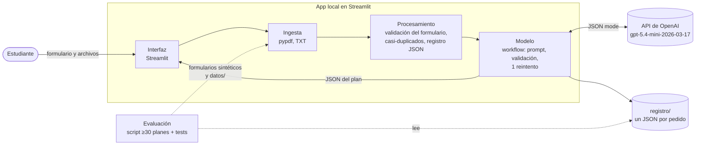

# Definición de la PoC — Study Copilot

**Documento del Hito 3 · Padilla, Marco; Sanches, Federico · se entrega con el tag `hito-3`**

Este documento es el contrato: lo que no está acá no se construye, y en la
semana 9 la PoC se valida contra los criterios de 2.3. Insumos:
[`canvas.md`](../hito_1/canvas.md) (Hito 1) y
[`4-veredicto.md`](../hito_2/4-veredicto.md) (Hito 2); las celdas citadas son
de [`eda-viabilidad.ipynb`](../hito_2/eda-viabilidad.ipynb). Tiene unas 4.600
palabras, más que las 3.000 de la plantilla: ver
[`decisiones-de-proceso.md`](../decisiones-de-proceso.md).

## Historial de versiones

| Versión | Fecha | Qué cambió |
|---|---|---|
| 0, Clase 5 | 2026-10-13 | Overview y Objetivo, sin tag |
| 0.1 | 2026-10-27 | Fuera de alcance y riesgos; canvas pasa a v4 |
| 0.2 | 2026-11-02 | Decisión del modelo (3.1.1) con la prueba de `experimentos/`; riesgo 1 con cifras |
| 0.3 | 2026-11-03 | Decisiones 3.1.2 a 3.1.5; salen del alcance la fecha del material, detectar material de otra materia, la anonimización y la escalabilidad |
| 0.4 | 2026-11-10 | Entra el contenido que elige el estudiante (preguntas de autoevaluación, ejercicios prácticos y preguntas tipo parcial), también sin archivos; los archivos se cargan por tema, más un material general. Cambian 1.1 a 1.4, 3.1.2 a 3.1.4 y 3.2. Se suspende en 1.3 la exclusión de los ejercicios tipo parcial |
| 0.4.1 | 2026-11-11 | Correcciones: enlaces al canvas y al notebook, movidos a `docs/hito_1/` y `docs/hito_2/`; la alternativa 3 de 3.1.3, que había quedado mezclada con la 2 |
| 0.5 | 2026-11-11 | Spec completa (2.1, 2.2 y 2.3), según la plantilla de la cátedra (`plantilla/`). Criterios: válidos ≥ 90% y prioridad coherente ≥ 80%; p90 ≤ 120 s; 5 de 5 escenarios; ventaja ≥ 30 puntos. La corrección del contenido queda como señal del riesgo 2. Se suspenden «sin umbral» de latencia (1.3 y 3.1.5) y «ninguna ventaja» (1.2) |
| 0.6 | 2026-11-12 | Plan de construcción (4.1). Recorte de unas 7.500 a unas 4.600 palabras, sin cambiar decisiones ni cifras; los textos suspendidos se conservan |

---

## 1. Propuesta

### 1.1 Overview

El estudiante completa un formulario (materia, temas con su nivel, fecha de
examen, horas por día y objetivo), sube si los tiene los PDF o TXT de su
cursada, por tema o generales, y elige el contenido: preguntas de
autoevaluación, ejercicios prácticos o preguntas tipo parcial. Ve un plan día
por día que respeta sus horas, cubre los temas y explica cada prioridad, y el
contenido pedido, todo como borrador; sin archivos, la pantalla marca que se
generó con el conocimiento del modelo. Es para quien prepara un examen con
varias materias compitiendo por las mismas horas. La PoC no sale a usuarios:
usa los 14 archivos reales de `datos/` y formularios sintéticos, porque no
existe ninguno real (celda 2). Quedan afuera los resúmenes, la conversación y
lo que lista 1.3.

El veredicto del Hito 2 fue **ajustar el alcance**: el banco es procesable (13
de 13 PDF con texto, celda 4), pero sólo 1 de 3 materias tiene temario (celda
3), así que la prioridad no usa el peso de cada tema; cubre 1 carrera (celda
6), y el 55% del texto son compilaciones de estudiantes (celda 7), así que lo
generado se presenta para revisar.

### 1.2 Objetivo

1. **Supuesto y riesgo.** De **factibilidad**: que un LLM por API genera un
   plan que respeta las horas, cubre los temas, prioriza según nivel, fecha y
   objetivo y explica cada prioridad, y que la ingesta distingue lo
   procesable. De **valor**: que ese plan es mejor que pedírselo a un chatbot,
   el competidor más fuerte (canvas, Sección 4); el riesgo es la refutación de
   la Sección 3 del canvas. Usabilidad y viabilidad no se prueban: no hay
   usuarios ni línea de base. La corrección del contenido es el riesgo 2, no
   el supuesto.
2. **Qué lo valida.** Los criterios de 2.3 en la semana 9: sobre ≥30 planes,
   el 90% válidos por código (proxy técnico del canvas, Sección 6), y una
   ventaja de al menos 30 puntos sobre el *baseline* (una llamada única).
3. **Qué decisión habilita.** **GO**, con 2.3 cumplido: congelar el alcance en
   la semana 10 y pasar a una prueba de uso real, lo único que mide las
   métricas de negocio. **Cambiar el enfoque**, si la validez no llega al 90%
   o la prioridad al 80% con los planes B agotados: una regla determinista
   (horas proporcionales a 1 − nivel, ningún tema en cero, repaso al final)
   arma el cronograma y el LLM sólo explica y genera contenido. **NO GO**:
   validez bajo el 50% o ventaja menor a 30 puntos; se vuelve a la Sección 4
   del canvas. Un escenario de 2.1 sin cubrir se corrige antes del GO; una
   latencia sobre el techo pasa al plan B del riesgo 3.
   *Suspendido en la v0.5:* «NO GO: [...] o ninguna ventaja sobre el
   *baseline*». Con el umbral de 2.3, una ventaja de entre 0 y 30 puntos no
   cumplía el GO ni caía en el NO GO.

### 1.3 Fuera de alcance

- **Priorizar por el peso real de cada tema.** Requiere temario, y sólo 1 de 3
  materias lo tiene (celda 3).
- **Materias fuera de Ing. en Sistemas.** El banco cubre 1 carrera y 1
  institución (celda 6).
- **Mostrar la fecha del material.** El veredicto la pedía, pero un material
  viejo puede seguir vigente, y 6 de 14 archivos no la tienen (celda 5). Ver
  3.1.2.
- **Detectar material de otra materia.** El veredicto lo ponía en el camino de
  error; se deja afuera para acotar. El plan no cambia, porque los temas salen
  del formulario; el contenido sí puede apoyarse en ese material.
- **PDF escaneados, fotos y otros formatos.** El banco no tiene ninguno sin
  texto (celda 4), así que un OCR no se podría evaluar. Se rechazan con un
  mensaje: es un caso borde (2.1.3).
- **Resúmenes.** Del material complementario entran los tres tipos de
  contenido (desde la v0.4); los resúmenes, no.
  *Suspendido en la v0.4:* «sólo las preguntas de autoevaluación; los
  ejercicios tipo parcial, afuera». El motivo era que medir la corrección
  conceptual pide una rúbrica con 2 revisores (EDA, confiabilidad) y para un
  tipo de pieza entra en tres semanas, para tres no. Lo reemplaza la decisión
  del equipo de incluir los tres tipos; el costo de esa rúbrica sobre tres
  tipos queda como parte del riesgo 2 de 1.4, sin resolver.
- **Ajustar el plan conversando** (caso de uso 2 del canvas). Se vuelve a
  cargar el formulario.
- **Resultado académico y métricas de negocio** (adherencia, retención, tiempo
  de planificación). Sin línea de base ni usuarios; quedan para la prueba de
  uso.
- **Cuentas, persistencia, calendarios y despliegue.** La PoC corre local, para
  una persona por vez.
- **Escalabilidad y límite de costo por plan.** Sin usuarios no hay carga, y lo
  medido en 3.1.1 no es línea de base. El costo se registra por pedido, sin
  umbral (3.1.5).
  *Suspendido en la v0.5:* «límites de latencia [...] Latencia y costo se
  registran por pedido, sin umbral». La plantilla pide un criterio de latencia
  con percentil; queda fijado en 2.3 como techo de tolerancia para la demo
  (p90 ≤ 120 s), no como límite de producto.
- **Anonimizar el material antes de enviarlo a OpenAI.** Sólo se procesa el
  banco. Los metadatos con autor (5 de 14, celda 7) no se envían, pero el
  cuerpo de un archivo nombra a un docente (datasheet). Es condición para la
  prueba de uso.

### 1.4 Riesgos

**1. El LLM no respeta las restricciones numéricas.** Sale del supuesto de
1.2: un LLM puede devolver un plan plausible cuyas horas no cierran. En 3.1.1,
17 de 18 planes son válidos, pero la prioridad falla en 4 de 18 y el
reintento no la corrigió. Señal: validez bajo el 90%. Plan B: verificación y
un reintento con el error; si no alcanza, la regla determinista de 1.2 arma el
cronograma y el LLM sólo explica.

**2. El contenido generado tiene errores conceptuales.** Sale del veredicto:
es el riesgo central no estimado, y el 55% del texto son compilaciones de
estudiantes de fidelidad no verificada (celda 7). Desde la v0.4 crece: hay
tres tipos de pieza y se generan aun sin archivos, sin un fragmento en el que
apoyarse. Señal: menos del 80% de las piezas de la muestra aprobadas por la
rúbrica, por tipo. Plan B: cada pieza cita el fragmento del que sale, y la
generada sin archivos se marca (la PoC ya lo hace); si no alcanza, las
preguntas se extraen de los parciales subidos (7 exámenes en el banco, celda
2). Ese último plan B no cubre los ejercicios ni los pedidos sin archivos.

**3. Lo que sube el usuario no se puede usar.** Sale del veredicto: el banco lo
eligió el equipo. En él, 1 de 13 PDF está malformado (celda 4); en uso puede
llegar un escaneado, otra materia o más texto del que conviene mandar (el banco
suma 158.120 caracteres, celda 2). Señal: un archivo del banco que rompe la
ingesta en vez de dar un mensaje. Plan B: límite de tamaño por archivo y por
pedido, rechazo de lo que no tiene texto, y mandar al modelo sólo los
fragmentos que mencionan los temas del formulario.

---

## 2. Spec

### 2.1 Escenarios

#### Happy path

- **Dado** un estudiante de Gestión de Datos (la materia con temario), con 3
  temas de niveles distintos, fecha, horas por día, objetivo y PDF legibles en
  cada tema
- **Cuando** pide el plan y las preguntas de autoevaluación
- **Entonces** el sistema valida el formulario y extrae el texto de cada archivo
- **Y** muestra un plan día por día que respeta las horas de cada día y cubre
  los 3 temas con su nombre
- **Y** el tema de nivel más bajo recibe más minutos que el de nivel más alto
- **Y** cada tema tiene su explicación
- **Y** las preguntas de cada tema aparecen como borrador, con los archivos en
  los que se apoyan
- **Y** el pedido queda registrado

#### Casos borde

##### 2.1.1 Materia sin temario

- **Dado** un estudiante de Investigación Operativa, sin temario (celda 3), con
  parciales y prácticas cargados
- **Cuando** pide el plan
- **Entonces** el plan cubre todos los temas y respeta las horas
- **Y** cada explicación justifica la prioridad con nivel, fecha, horas u
  objetivo, sin atribuirle a un tema un peso en el examen
- **Le cuesta al usuario:** que un tema que pesa mucho, pero que declaró saber
  bien, reciba poco tiempo.

##### 2.1.2 Sin archivos

- **Dado** un formulario completo, sin archivos
- **Cuando** pide el plan y ejercicios prácticos
- **Entonces** el sistema los genera con el conocimiento general del modelo
- **Y** la pantalla marca que se generaron sin material
- **Y** el registro deja constancia de que no hubo archivos
- **Le cuesta al usuario:** estudiar con un ejercicio equivocado sin un
  fragmento contra el cual contrastarlo.

##### 2.1.3 Archivo ilegible o con un formato no admitido

- **Dado** un tema con un PDF legible y otro escaneado, sin texto, o que no es
  PDF ni TXT
- **Cuando** pide el plan
- **Entonces** el sistema rechaza ese archivo con un mensaje que lo nombra y
  dice por qué
- **Y** el pedido sigue con los archivos legibles
- **Y** el registro guarda el aviso
- **Le cuesta al usuario:** creer que el plan tuvo en cuenta un material que no
  se leyó.

##### 2.1.4 Muchos temas en pocas horas (peor caso borde)

- **Dado** un formulario de Redes con 6 temas de niveles distintos y 5 horas en
  3 días, donde falló la prioridad en 3.1.1
- **Cuando** pide el plan
- **Entonces** el plan respeta las horas y cubre los 6 temas
- **Y** el promedio de minutos por nivel cumple bajo ≥ medio ≥ alto
- **Y** si después del reintento no lo cumple, el plan se muestra marcado con
  el error de prioridad (3.1.3, paso 5)
- **Le cuesta al usuario:** dedicarle menos tiempo a lo que menos sabe, que es
  lo que el producto promete evitar. Lo retoma 2.2.

#### Error del sistema

- **Dado** un plan que no pasa la validación: un día se pasa de las horas o
  falta un tema
- **Cuando** el reintento, con los errores concretos, tampoco lo corrige
- **Entonces** el sistema muestra el plan marcado con esos errores, sin
  presentarlo como válido
- **Y** el registro guarda los dos intentos y sus errores
- **Y** el usuario puede volver a pedir, o ajustar el formulario (menos temas o
  más horas)

La caída de la API no es este escenario: es un requerimiento de 3.1.5.

### 2.2 User experience

1. **Interacción y control.** El usuario completa el formulario en una app
   local de Streamlit y controla todo lo que recibe el modelo: los temas salen
   del formulario, y el modelo no puede agregar ni quitar ninguno (la
   validación lo rechaza). No controla cómo se reparten los minutos ni puede
   ajustar el plan conversando (1.3).
2. **Señal de confianza.** No hay un puntaje: el modelo no da uno confiable. La
   señal es binaria: todo es borrador; cada tema dice en qué archivos se
   apoyó; el contenido sin material lo dice; un plan que no pasó la validación
   se muestra marcado; los archivos rechazados y los casi-duplicados se avisan
   con su nombre.
3. **Corrección o aviso.** No se puede editar la salida ni avisar que está mal:
   no hay tabla de feedback (3.1.2). Para corregir, el usuario cambia el
   formulario y vuelve a pedir.
4. **Peor caso borde (2.1.4).** Si la prioridad sigue mal después del
   reintento, el usuario ve el plan con una marca que dice que un tema de
   nivel más bajo recibió menos minutos que otro de nivel más alto. Puede
   sumar horas o sacar los temas que mejor sabe y volver a pedir, o usar el
   plan sabiendo dónde falla.

### 2.3 Criterios de aceptación

| Criterio | Métrica (qué cuenta como respuesta aceptable) | Umbral (uno por tipo de error, si un error cuesta más que el otro) | Conjunto de evaluación | Cómo se chequea |
|---|---|---|---|---|
| Calidad de la respuesta | Plan válido: respeta las horas de cada día, cubre los temas con su nombre, no inventa temas y explica cada uno. Aparte, prioridad coherente: minutos por nivel bajo ≥ medio ≥ alto | Plan inválido, que no se puede usar: válidos ≥ 90%. Prioridad incoherente, que se usa pero no cumple la promesa: coherentes ≥ 80% (en 3.1.1, 14 de 18) | ≥ 30 planes de las 3 materias, con formularios sintéticos no usados para ajustar los prompts | El script cuenta los planes que pasan cada validación |
| Latencia (con el percentil) | Del envío del formulario al resultado, con el reintento; p90 | p90 ≤ 120 s: techo para una demo, no límite de producto (con el material entero, Redes tardó 79 s) | Los mismos ≥ 30 pedidos | El script calcula el p90 de los tiempos del registro |
| Cobertura de los casos borde | El sistema hace todo lo que dicen el «Entonces» y cada «Y» del escenario. Entran los 4 casos borde y el error del sistema | 5 de 5 escenarios cubiertos | Un formulario por escenario, más dos archivos de prueba para 2.1.3 que el banco no tiene (celda 4) | Una lista de sí o no por escenario: tests para rechazos, marcas y registro; la pantalla, en la demo de la semana 9 |
| Ventaja sobre el *baseline* | Diferencia en puntos entre los planes válidos del workflow y del *baseline*, con la misma validación, que exige los nombres de los temas porque el producto tiene que verificar la cobertura | Workflow − *baseline* ≥ 30 puntos: más que la variación entre dos corridas en 3.1.1 (hasta 2 de 9, unos 22 puntos) | Los mismos ≥ 30 formularios, con las dos variantes | El script compara los porcentajes |

La corrección conceptual del contenido no es un criterio de aceptación (1.2):
se mide con la rúbrica sobre una muestra, como señal del riesgo 2.

---

## 3. Diseño

### 3.1 Decisiones de diseño

#### 3.1.1 El modelo

**Contexto.** Un LLM por API genera el plan y el contenido; no se entrena
nada. Restricciones: sólo la API de OpenAI, tres semanas, dos personas. La
prueba (`experimentos/prueba_modelo.py`, 2026-11-02) corrió 3 formularios
sintéticos (con temario, sin temario, y 6 temas en 5 horas) con el texto real
de los archivos, y midió por código la validez y la prioridad, como en 2.3. El
contenido no entró en la prueba.

**Alternativas evaluadas.**

1. **Baseline: una llamada única**, como con un chatbot. Con
   `gpt-5.4-mini-2026-03-17`: 0 de 18 válidos. Respeta las horas en 14 de 18,
   pero nunca conserva los nombres de los temas ("SQL: consultas y
   subconsultas" pasa a "SQL: consultas básicas, SELECT/FROM/WHERE…"), así que
   no se puede verificar la cobertura ni medir la prioridad. Descartada; es la
   vara del criterio de ventaja.
2. **Workflow con el mismo modelo:** reglas en el prompt, validación por código
   y un reintento. 17 de 18 válidos (10 al primer intento), 18 de 18 conservan
   los temas, prioridad coherente en 14 de 18; 3,8 s y unos 13.900 tokens de media, contra 4,6 s y 9.200 del
   baseline. Sigue en pie.
3. **El workflow con `gpt-4.1-mini-2025-04-14`**: 9 de 9 válidos, pero
   prioridad coherente en 3 de 9, y 5,9 s. Descartada: falla justo en priorizar.
4. **Claude.** Descartado sin probar: no hay API disponible. La regla
   determinista es plan B (1.4), no alternativa: no prueba la pieza de IA.

**Decisión.** La 2, con `gpt-5.4-mini-2026-03-17` fijado por versión y
configurable por `OPENAI_MODEL`: es la única que produce planes verificables y
prioriza mejor que la 3.

**Consecuencias.** Se asume que reglas, validación y reintento alcanzan para la
prioridad, y la prueba no lo sostiene del todo: falla en 4 de 18, y el único
reintento que tuvo que corregirla no lo logró (riesgo 1). Las fallas de la
segunda corrida fueron con 6 temas en 5 horas (caso borde 2.1.4). Se resignan
un 50% más de tokens, que el material salga sin anonimizar (1.3) y la
independencia del proveedor. Dos corridas de 9 planes variaron hasta 2: la
prueba sirve para elegir el diseño, no para los umbrales.

#### 3.1.2 Los datos

**Contexto.** No hay corpus: el material llega en cada pedido. El plan del
pipeline del veredicto (sección 4) fija ingesta, casi-duplicados, fecha del
material, banco de pruebas, registro y partición, pero no cuánto texto llega
al modelo. La prueba de 3.1.1 usó un tope de 30.000
caracteres: Gestión de Datos (19.832) e Investigación Operativa (29.058)
entraron enteras, pero en Redes, que suma unos 109.000 (celda 2),
`examen_01.pdf` se recortó a 30.000 de 54.002 y dos archivos quedaron afuera.

**Alternativas evaluadas.**

1. **Truncar con prioridad** hasta un tope. En Redes, el plan no ve la mayor
   parte del material. Descartada.
2. **Sólo los fragmentos que mencionan los temas.** Depende de que el
   vocabulario coincida, y el 55% del texto son compilaciones con su propia
   terminología (celda 7). Queda como plan B del riesgo 3.
3. **Embeddings.** Descartada: no entra en tres semanas, y el material cabe en
   la ventana del modelo.
4. **Mandar todo el material, entero.** Sigue en pie.

**Decisión.** La 4. **Se mantienen** la ingesta de PDF (`pypdf`) y TXT con
rechazo, `datos/` como banco de pruebas, el registro por pedido (formulario,
archivos, avisos, plan, intentos, tokens y tiempo) y la partición, por
formulario y fecha: ningún formulario usado para ajustar los prompts entra en
los ≥30 planes. **Cambian**: el material va entero, agrupado por tema y
general; no se extrae la fecha; los casi-duplicados sólo se avisan; no hay
tabla de feedback.

**Consecuencias.** Como 3.1.1 se midió con tope, la prueba se vuelve a correr
sin él, empezando por Redes. Se resigna costo: unos 27.000 tokens de material
por plan de Redes, repetidos en el reintento. Si una materia no cabe o el
costo no se sostiene, se pasa al plan B del riesgo 3. Sin fecha, se asume que
quien sube el material sabe si está vigente. Mandar todo entero aumenta lo que
sale hacia OpenAI: antes de la prueba de uso hay que anonimizar.

#### 3.1.3 Workflow o agente

**Contexto.** Los pasos se conocen de antemano y son siempre los mismos. Lo
difícil es aritmético, y el modelo solo no lo resuelve: 0 de 18 válidos con
una llamada, 17 de 18 con verificación y reintento (3.1.1).

**Alternativas evaluadas.**

1. **Una llamada:** el *baseline* de 3.1.1. Descartada; queda como vara.
2. **Workflow con pasos fijados por el equipo**, con el modelo en un solo paso.
   Es lo que se midió en 3.1.1. Sigue en pie.
3. **Una llamada por pieza:** plan por un lado, contenido de cada tema por
   otro. Salidas más cortas, pero más llamadas y latencia. Descartada: una
   sola salida es más fácil de validar y registrar. Es la primera candidata si
   la nueva corrida muestra que el costo o la latencia no se sostienen.
4. **Agente** con herramientas. Sirve cuando el camino no se conoce de
   antemano, que no es el caso; su costo varía por pedido, es más difícil de
   evaluar y no está medido. Descartada.

**Decisión.** La 2, con estos pasos:

1. **Validación del formulario** (código): campos, niveles, horas, días
   anteriores al examen y tipos de contenido.
2. **Ingesta** (código), según 3.1.2; sin archivos legibles, se sigue y se marca.
3. **Generación** (LLM, una llamada): devuelve un JSON con el plan, las
   explicaciones y el contenido pedido por tema.
4. **Validación del JSON** (código): formato, horas, cobertura, temas
   inventados, explicaciones, prioridad y un ítem por tipo pedido y tema.
5. **Reintento** (a lo sumo uno) con esos errores; si sigue mal, el plan se
   muestra marcado.
6. **Registro y pantalla** (código): plan, explicaciones y una pestaña por tipo
   de contenido, como borrador, con los archivos de cada tema.

**Consecuencias.** Una o dos llamadas por pedido, verificables contra 2.3. Lo
que no está en los pasos queda afuera (1.3). El contenido viaja con el plan:
la salida es más larga, el reintento lo regenera y la prueba no lo incluía,
así que entra en la nueva corrida. La validación no mide si el contenido es
correcto (riesgo 2). El material de otra materia llega igual al modelo y
puede afectar el contenido, no el plan.

#### 3.1.4 Construir o usar hecho

**Contexto.** Las piezas salen de 3.1.3. Restricciones: Python, PoC local y
sólo la API de OpenAI.

**Alternativas evaluadas.**

1. **Interfaz.** *Flask o FastAPI*: backend y frontend que mantener. *Línea de
   comandos*: no muestra el plan formateado. *Gradio*: pensado para entrada y
   salida simples, no para una cantidad variable de temas. *Streamlit*: todo
   en Python. Sigue en pie.
2. **Salida del modelo.** *Structured Outputs*: la validación hace falta igual
   y la prueba no se midió así. *JSON mode*: es lo que se midió. Sigue en pie.
3. **Validación.** *Pydantic*: duplica lo que ya chequea `validar()`. *Código
   propio*, a partir de `validar()` y `errores_prioridad()`. Sigue en pie.
4. **Casi-duplicados.** *Una librería* (*MinHash*): pensada para colecciones
   grandes. *Jaccard propio* (celda 10). Sigue en pie.
5. **Registro.** *SQLite*: consultas que no hacen falta. *Un JSON por pedido*.
   Sigue en pie.

**Decisión.**

| Pieza | Se usa hecho | Se construye |
|---|---|---|
| Interfaz | Streamlit | El formulario (archivos por tema, material general, contenido elegido) y la vista del resultado |
| Ingesta | `pypdf`; lectura de TXT de la librería estándar | Las reglas de rechazo y sus mensajes |
| Casi-duplicados | — | Jaccard sobre vocabulario, umbral 0,30 (celda 10) |
| Generación | SDK `openai`, `gpt-5.4-mini-2026-03-17` en JSON mode; `python-dotenv` | Los prompts con las reglas |
| Validación y reintento | — | A partir de `validar()` y `errores_prioridad()`, más el contenido por tema |
| Registro | `json` de la librería estándar | Un archivo por pedido (3.1.2) |

Se usa hecho lo que no es el producto; se construye lo que el producto promete
y 2.3 verifica: las reglas del plan y su validación.

**Consecuencias.** Como Streamlit reejecuta el script en cada interacción, el
resultado se guarda en la sesión para no disparar otra llamada. Un JSON con la
forma equivocada consume el reintento; si pasa seguido, se pasa a Structured
Outputs. Hay que mantener ingesta, Jaccard, prompts y validación. Se resigna
la independencia del proveedor.

#### 3.1.5 Requerimientos no funcionales

**Contexto.** La PoC prueba el plan y la ingesta (1.2), local y sobre `datos/`.

**Alternativas evaluadas.**

1. **Las tres propiedades a nivel de producto.** Descartada: sin línea de base
   ni usuarios, y no entra en tres semanas.
2. **Sólo confiabilidad.** Descartada: sin tests, cada cambio de prompt deja
   sin saber si los ≥30 planes siguen pasando.
3. **Confiabilidad primero, mantenibilidad después, escalabilidad afuera**, sin
   integración continua ni prompts en archivos aparte, que con dos personas no
   cambian lo verificable. Sigue en pie.

**Decisión.** La 3.

| Propiedad | Prioridad | Nivel que fija la PoC | Cómo se verifica |
|---|---|---|---|
| Confiable | 1 | ≥90% de planes válidos sobre ≥30 (1.2) | El script de evaluación |
| | | 0 de 14 archivos del banco rompen la ingesta | Test automático sobre `datos/` |
| | | Un error de la API (timeout, sin crédito, respuesta que no es JSON) se muestra y se registra; la app no se cae | Test con la API simulada |
| Mantenible | 2 | Tests de la validación y de la ingesta | Se corren antes de cada tag |
| | | Modelo por variable de entorno (`OPENAI_MODEL`) | Cambiarlo no toca el código |
| | | Evaluación reproducible: un script corre los ≥30 planes y guarda los resultados | Un comando, el mismo para los dos |
| Escalable | 3 | No se busca (1.3) | — |

El costo no tiene umbral: se registra por pedido. La latencia tiene el techo
de 2.3 (p90 ≤ 120 s). *Suspendido en la v0.5:* «Latencia y costo no tienen
umbral», por el criterio de latencia que pide la plantilla (2.3).

**Consecuencias.** Se fija la confiabilidad del plan y de la ingesta, no la del
servicio: si la API falla, el usuario vuelve a pedir. Cada corrida del script
cuesta, así que se corre antes de cada decisión y en la semana 9. Sin
integración continua, los tests dependen de que alguien los corra. Un GO va a
pedir despliegue, concurrencia y límites de costo que la PoC no construye.

*Suspendido en la v0.5:* «Sin límite de latencia, un plan de Redes con el
material entero y las preguntas puede tardar más de lo aceptable; si pasa, los
datos del registro permiten fijar el límite después». Lo reemplaza el techo de
2.3: si un pedido lo supera de forma sistemática, se pasa al plan B del riesgo 3
(límite por pedido y fragmentos por tema).

### 3.2 Arquitectura

| Pieza | Qué es en este proyecto | Se construye o se usa hecha | Con qué (API, modelo preentrenado, librería) |
|---|---|---|---|
| **Ingesta** | Extrae el texto de cada archivo y rechaza lo ilegible | Hecha la lectura; se construyen los rechazos | `pypdf`; librería estándar; Streamlit |
| **Procesamiento** | Valida el formulario, detecta casi-duplicados, arma el material y registra | Se construye | Jaccard propio (celda 10); `json` |
| **Modelo o agente** | El workflow de 3.1.3 | Hecho el modelo; se construyen prompts, validación y reintento | SDK `openai`, `gpt-5.4-mini-2026-03-17`, JSON mode |
| **Interfaz** | App local de formulario y resultado (2.2) | Hecho el framework; se construyen las pantallas | Streamlit |
| **Evaluación** | Script de los criterios de 2.3 sobre el conjunto congelado; tests; rúbrica a mano | Se construye | A partir de [`prueba_modelo.py`](../../experimentos/prueba_modelo.py); `pytest` |

---

## 4. Plan

### 4.1 Plan de construcción

Ya existen la app, el workflow y sus tests en `poc/` y `tests/` (10/11),
incluido el de ingesta sobre los 14 archivos; el *baseline*, en
[`prueba_modelo.py`](../../experimentos/prueba_modelo.py). Falta el conjunto
de evaluación, el *baseline* dentro de la app y el script de evaluación.

| Semana | Meta | Qué se construye | Quién | Qué se muestra al cierre |
|---|---|---|---|---|
| 7, Workshop 1 | Datos listos | El conjunto congelado: ≥ 30 formularios sintéticos de las 3 materias, uno por escenario de 2.1 y los 2 archivos de prueba de 2.1.3 | Marco Padilla | El conjunto en el repo y el test de ingesta con 14 de 14 |
| 8, Workshop 2 | *Baseline* de punta a punta | El *baseline* del formulario al registro (Federico Sanches); el script de validez, prioridad y latencia (Marco Padilla) | Federico Sanches y Marco Padilla | El *baseline* sobre el conjunto, con su porcentaje de válidos y su p90 |
| 9, Workshop 3 | Evaluación contra los criterios de aceptación | El workflow en el script, la ventaja, la lista de los 5 escenarios y la rúbrica sobre una muestra | Federico Sanches y Marco Padilla | La tabla de 2.3 con sí o no por fila, y la decisión según 1.2 |
